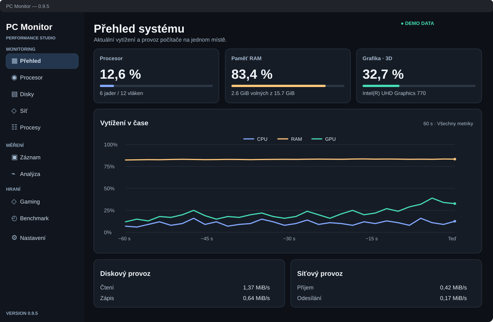

<p align="center">
  
</p>

<h1 align="center">PC Monitor</h1>

<p align="center"><strong>Monitor. Analyze. Optimize.</strong><br>Real-time hardware monitoring and gaming performance analysis for Windows.</p>

<p align="center">
  <a href="https://github.com/smety-dev/PC-Monitor/releases"></a>
  <a href="https://github.com/smety-dev/PC-Monitor/actions/workflows/windows-build.yml"></a>
  <a href="LICENSE"></a>
  
  <a href="https://github.com/smety-dev/PC-Monitor/releases"></a>
</p>

<p align="center">
  <a href="https://github.com/smety-dev/PC-Monitor/releases"><strong>Download for Windows</strong></a> ·
  <a href="https://smety-dev.github.io/PC-Monitor/">Website</a> ·
  <a href="GUIDE.md">User &amp; developer guide</a> ·
  <a href="ROADMAP.md">Roadmap</a> ·
  <a href="https://github.com/smety-dev/PC-Monitor/issues">Feedback</a>
</p>

**Current version: v0.9.6 — International Update (release candidate)**

PC Monitor brings hardware telemetry, process inspection, recording and gaming benchmarks into one dark desktop workspace. The portable release runs without installing Python. The v0.9.6 candidate offers Czech and English, with automatic system-language selection and a saved choice in Settings. Restart the application to apply a language change. The older v0.9.5 build is primarily Czech.

<p align="center"></p>

<p align="center"><em>English interface preview for v0.9.6. Illustrative dashboard with simulated values, not measured results.</em></p>

## What you can do

| Workspace | Features |
| --- | --- |
| Hardware dashboard | CPU, GPU 3D and RAM utilization; live history and device details |
| CPU, storage & network | Per-logical-processor utilization, OS-reported frequency, disk capacity and throughput |
| Processes | Read-only process list with CPU/RAM usage, search and sorting |
| Recording & analysis | Local hardware CSV recording, offline charts and statistics |
| Gaming overlay | Configurable desktop overlay with hardware and optional frame metrics |
| FPS & frametime | PresentMon-based present-rate FPS, rolling 1% low and frametime history |
| Benchmark | Timed frame capture, stutter metrics and A/B comparison |
| Settings | Persistent local preferences, overlay configuration and language choice (v0.9.6 candidate) |

## Download & run

The source version is v0.9.6. Open Releases for the latest published build; v0.9.5 is the previous Czech-interface beta.

1. Open [Releases](https://github.com/smety-dev/PC-Monitor/releases).
2. Choose the desired published version and download its `PC-Monitor-v*-Windows-x64.zip` from **Assets**.
3. Extract the **entire** ZIP into a writable folder.
4. Run `PC-Monitor.exe`. Keep the `_internal` and `tools` folders alongside it.

No Python installation is required for the portable build. The executable is unsigned; Windows may show a SmartScreen warning. Verify the release checksum and only download from the official repository.

## Beta status

- Intended for Windows 10/11 x64; compatibility across configurations is not fully tested.
- Automated regression tests and Windows startup smoke test passed for the first beta.
- Portable launch was manually verified; live FPS capture in real games still needs validation.
- PresentMon requires authorized ETW access. Desktop overlays may not appear in exclusive fullscreen.
- GPU readings represent detected 3D engine utilization, not total GPU load or VRAM.
- Temperature monitoring is not included. No telemetry is uploaded by the application.
- Language selection affects application UI, not CSV schemas; native OS dialogs and external diagnostics may retain their original language.
- See [release notes](https://github.com/smety-dev/PC-Monitor/releases) and [third-party notices](THIRD_PARTY_NOTICES.md) for limitations. Redistribution license review remains open.

## Develop from source

```powershell
python -m pip install -r requirements.txt
python -m pc_monitor.gaming.presentmon_bundle
python main.py
```

The PresentMon setup is optional for hardware monitoring. For regression tests, run `python -m unittest discover -v`. See the [detailed guide](https://github.com/smety-dev/PC-Monitor/blob/main/GUIDE.md) for architecture, permissions, CSV formats, benchmark definitions and Windows build instructions.

## Repository structure

| Path | Purpose |
| --- | --- |
| `main.py` | Application entry point |
| `pc_monitor/ui/` | Qt interface, charts, dialogs and overlay |
| `pc_monitor/core/` | Hardware/process metrics, recordings, preferences |
| `pc_monitor/gaming/` | FPS capture and benchmark calculations |
| `pc_monitor/locales/` | Language selection and translations |
| `tests/` | Automated regression tests |
| `scripts/` | Windows executable packaging |
| `docs/` | Website and visual assets |
| `.github/` | CI and community templates |

Run the app and tests from the repository root using the commands above.

## Project links

- [Changelog](CHANGELOG.md) — development history
- [Roadmap](ROADMAP.md) — planned work, not guaranteed release dates
- [Contributing](CONTRIBUTING.md) — report bugs and suggest improvements
- [Security](SECURITY.md) — responsible vulnerability reporting

## License

PC Monitor's own source code is licensed under [MIT](LICENSE). Bundled third-party components have separate terms; see [THIRD_PARTY_NOTICES.md](THIRD_PARTY_NOTICES.md).

Created by [smety-dev](https://github.com/smety-dev) as a first Python project to learn software development and build useful PC gaming tools.
